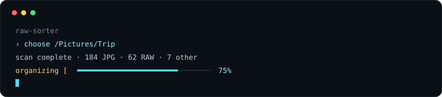
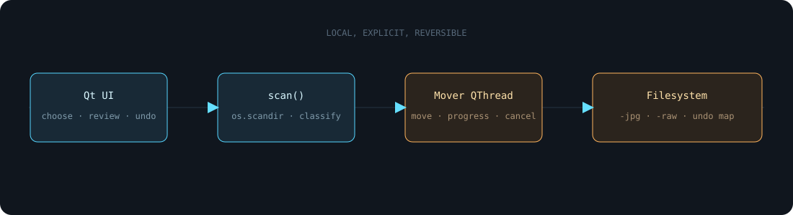
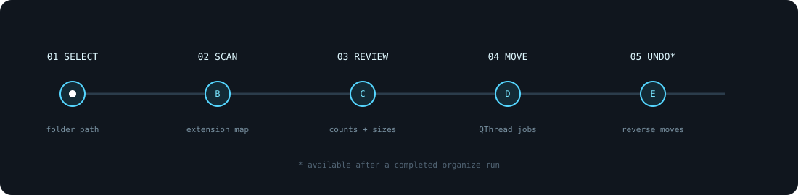
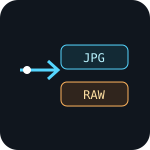

<div align="center">
  
</div>

<div align="center">

# Raw Sorter

### A focused desktop utility for turning one camera folder into two clean working sets.

<br>

[Quick start](#quick-start) · [How it works](#how-it-works) · [Installer](#one-click-setup) · [Project status](#project-status)

</div>

Raw Sorter is a small **PyQt6** application for photographers who want to separate finished JPEGs from camera originals without opening a command prompt or risking a destructive overwrite. Choose or drop a folder, review the scan, and organize the files in one deliberate pass.

<div align="center">
  
</div>

## What it does

- Scans **top-level files only** in the selected folder.
- Recognizes `.jpg`, `.jpeg`, `.jpe` and a broad set of camera RAW extensions, including `.cr2`, `.nef`, `.arw`, `.raf`, `.orf`, `.rw2`, `.dng`, `.raw`, `.iiq`, `.3fr` and more.
- Skips macOS `._` leftovers and Windows hidden/system files.
- Creates `<folder-name>-jpg` and `<folder-name>-raw` beside the source folder contents.
- Moves files with collision-safe names such as `image (1).jpg`.
- Reports progress, supports cancellation, and can undo the completed move.
- Leaves unsupported files where they are and reports them during review.

## How it works

<div align="center">
  
</div>

The UI stays responsive because the file operations run in a `QThread`. The scanner previews counts and sizes first; only the explicit **Organize** action creates destination folders and calls `shutil.move`.

### Core behavior

| Stage | Implementation | Result |
|---|---|---|
| Select | `QFileDialog` or drag and drop | A folder path |
| Inspect | `scan()` with `os.scandir()` | Sorted JPG, RAW and “other” lists |
| Plan | `Window.start()` | Destination paths and move jobs |
| Execute | `Mover.run()` in a `QThread` | Progress, moved files and failures |
| Recover | `Window.undo()` | Reverse moves for the successful operations |

<div align="center">
  
</div>

## Features

<table>
<tr>
<td width="33%" align="center">
  <br>
  <strong>Preview before moving</strong><br>
  <sub>Counts and total sizes are visible before any filesystem change.</sub>
</td>
<td width="33%" align="center">
  <br>
  <strong>Safe classification</strong><br>
  <sub>Known extensions are routed; everything else stays untouched.</sub>
</td>
<td width="33%" align="center">
  <br>
  <strong>Recoverable actions</strong><br>
  <sub>Successful moves are tracked so the last run can be reversed.</sub>
</td>
</tr>
</table>

## Tech stack

| Layer | Choice | Why it is here |
|---|---|---|
| Language | Python | Small, direct filesystem workflow |
| Desktop UI | PyQt6 | Native-feeling widgets, drag/drop and threaded signals |
| Filesystem | `os`, `pathlib`, `shutil` | Local scan, path normalization and moves |
| Packaging | PyInstaller | Windowed standalone build from the setup flow |
| Windows integration | PowerShell, `winreg`, shortcuts | Per-user install, Start menu/Desktop links and Apps & features registration |

## Quick start

### Prerequisites

- A supported Python 3 interpreter compatible with the installed PyQt6 release.
- A desktop environment supported by PyQt6.
- Internet access the first time you install PyQt6 from PyPI.

### Run from source

```powershell
python -m pip install PyQt6
python raw_sorter_final.py
```

The app opens with the light, frameless Raw Sorter window. Choose a folder from your Pictures directory, or drop a folder onto the window.

### One-click setup

`raw_sorter_setup.pyw` is a graphical installer. Double-click it on Windows, or launch it with:

```powershell
python raw_sorter_setup.pyw
```

On its first run the setup helper installs PyQt6 if it is missing, then offers:

- a local installation directory (default: `%LOCALAPPDATA%\Programs\RawSorter`);
- Desktop and Start menu shortcuts;
- an option to open Raw Sorter after installation.

The installer builds a windowed executable with PyInstaller, copies the source and setup helper into the installed `setup` directory, and registers the application in **Apps & features** on Windows. The installer’s removal flow removes the app and its shortcuts; it does not touch photo folders.

## Usage

1. Launch Raw Sorter.
2. Click **Choose Folder…** or drag a photo folder onto the drop zone.
3. Review the JPG and RAW counts, sizes and destination names.
4. Click **Organize _n_ files**.
5. Watch the progress card; **Cancel** stops before the next queued file.
6. Open the source folder, or use **Undo** to reverse successful moves.

For a folder named `Trip`, the resulting layout is:

```text
Trip/
├── Trip-jpg/          # .jpg, .jpeg, .jpe
└── Trip-raw/          # camera RAW extensions supported by the app
```

Existing destination files are never overwritten. If `Trip-jpg/IMG_0001.jpg` already exists, the next copy is moved as `IMG_0001 (1).jpg`, then `(2)`, and so on.

## Project structure

```text
.
├── raw_sorter_final.py    # PyQt6 app, scanner, worker, UI and source installer CLI
├── raw_sorter_setup.pyw   # graphical install/uninstall flow
├── LICENSE                # MIT License
├── assets/                 # README diagrams and motion graphics
│   ├── hero.svg
│   ├── architecture.svg
│   ├── workflow.svg
│   ├── animations/
│   ├── diagrams/
│   ├── feature-icons/
│   └── fallbacks/
└── README.md
```

## Technical notes

- `scan(folder)` uses `os.scandir()` and does not recurse into nested folders.
- File names are sorted case-insensitively for a stable preview.
- Hidden/system files on Windows and names beginning with `._` are ignored.
- Long Windows paths are normalized with the `\\?\` prefix when needed.
- Move failures are collected and shown instead of being silently treated as success.
- A named Windows mutex prevents two Raw Sorter instances from fighting over one folder.
- `--install` and `--uninstall` are supported by `raw_sorter_final.py` for the direct CLI installer path.

## Module reference

The project is intentionally small rather than split into a package:

| Symbol | File | Responsibility |
|---|---|---|
| `scan(folder)` | `raw_sorter_final.py` | Classify and case-insensitively sort top-level files |
| `unique(path)` | `raw_sorter_final.py` | Select a non-overwriting destination name |
| `Mover` | `raw_sorter_final.py` | Move jobs in a worker thread and emit progress/results |
| `Window` | `raw_sorter_final.py` | Main selection, review, progress, completion and undo states |
| `install()` / `uninstall()` | `raw_sorter_final.py` | Direct PyInstaller + shortcut lifecycle |
| `Job` | `raw_sorter_setup.pyw` | Installer worker with progress, cancellation and error logging |
| `Setup` | `raw_sorter_setup.pyw` | Graphical install/remove configuration flow |

There is no network API or daemon. The callable surface above is an implementation reference for contributors, not a stability promise for third-party imports.

## Configuration and environment

There are no required environment variables or configuration files. The source app uses the current user’s Pictures directory as the initial folder-picker location. The installed Windows app lives under the current user’s local application directory by default.

## Testing

This repository currently contains no automated test suite. Before a release, manually verify:

```powershell
python -m py_compile raw_sorter_final.py raw_sorter_setup.pyw
python raw_sorter_final.py
```

Use a disposable folder containing JPG, RAW, unsupported, hidden and duplicate-name fixtures. Confirm preview counts, collision suffixes, cancellation, undo, and the installer’s remove flow before using it on a card or archive.

## Project status

| Area | Status |
|---|---|
| Folder selection and drag/drop | Available |
| JPG/RAW classification | Available |
| Collision-safe moves | Available |
| Progress, cancellation and undo | Available |
| Windows shortcut installer | Available |
| Automated regression tests | Not present |
| Cross-platform packaging | Not documented or promised |

The roadmap is intentionally conservative: add coverage around the scanner and move planner first, then improve packaging and release automation without changing the “preview before move” contract.

## Contributing

Small, focused changes are welcome. Please:

1. Reproduce the behavior with a disposable fixture folder.
2. Keep filesystem changes explicit and reversible where possible.
3. Run `python -m py_compile raw_sorter_final.py raw_sorter_setup.pyw`.
4. Describe the platform and Python/PyQt6 versions used in the pull request.

Please preserve the copyright and license notices when redistributing or substantially copying the project.

## License

Raw Sorter is released under the [MIT License](./LICENSE).

The README’s motion language uses original, local SVG artwork authored for this project. The visual approach is informed by the public techniques named in the brief—SMIL animation, capsule-style headers, typing reveals and animated diagrams—but no external runtime, JavaScript or remote image dependency is required.
